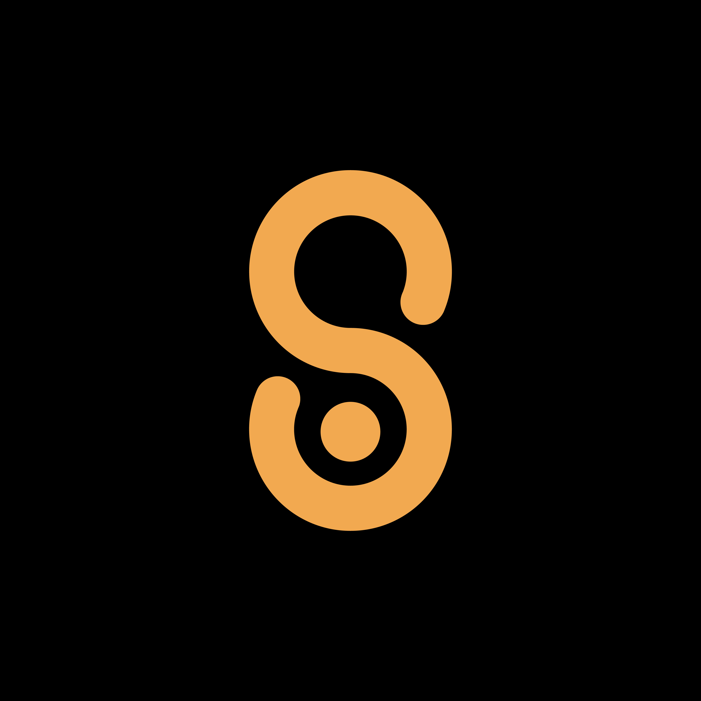
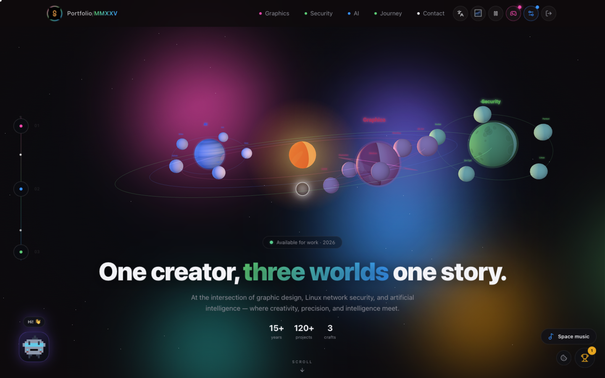
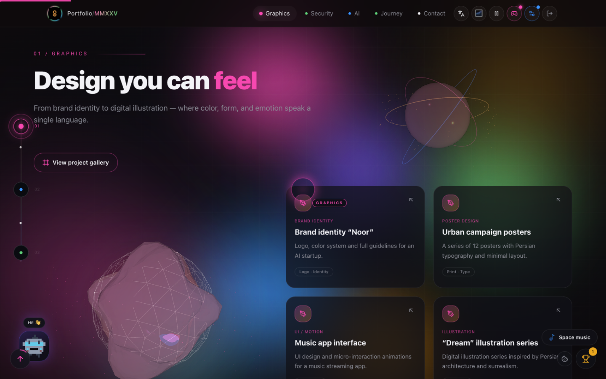
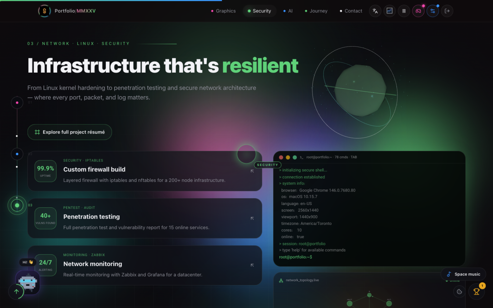
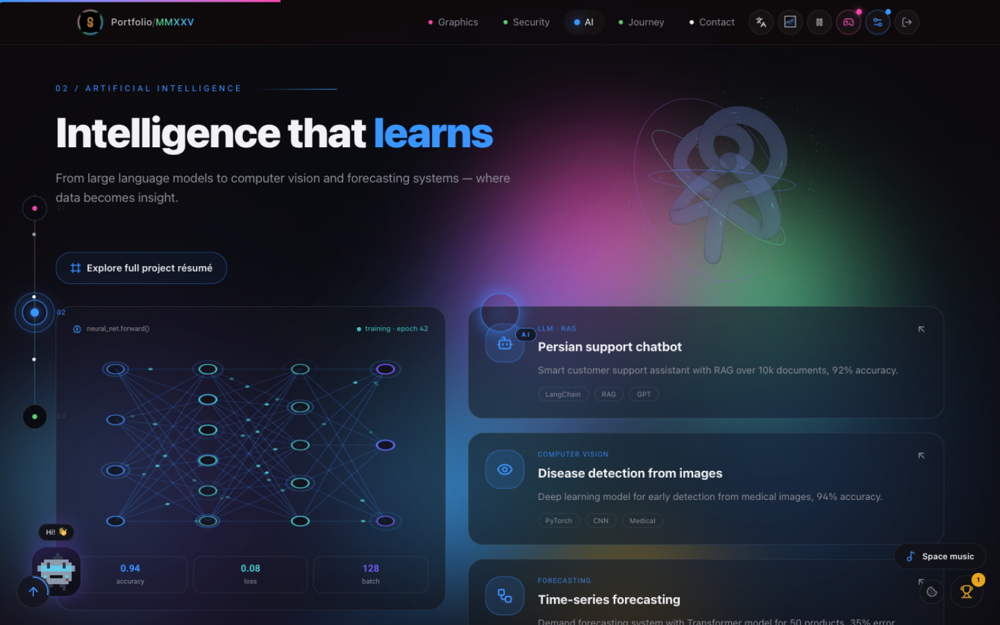
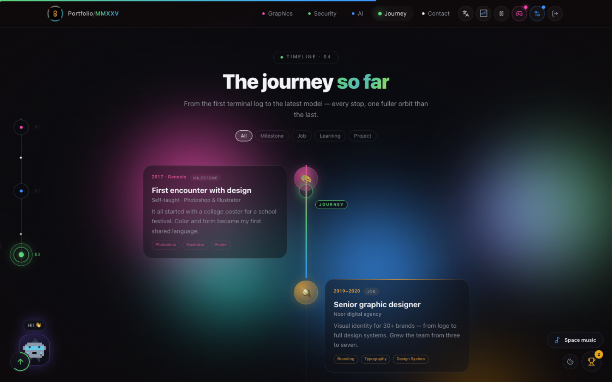
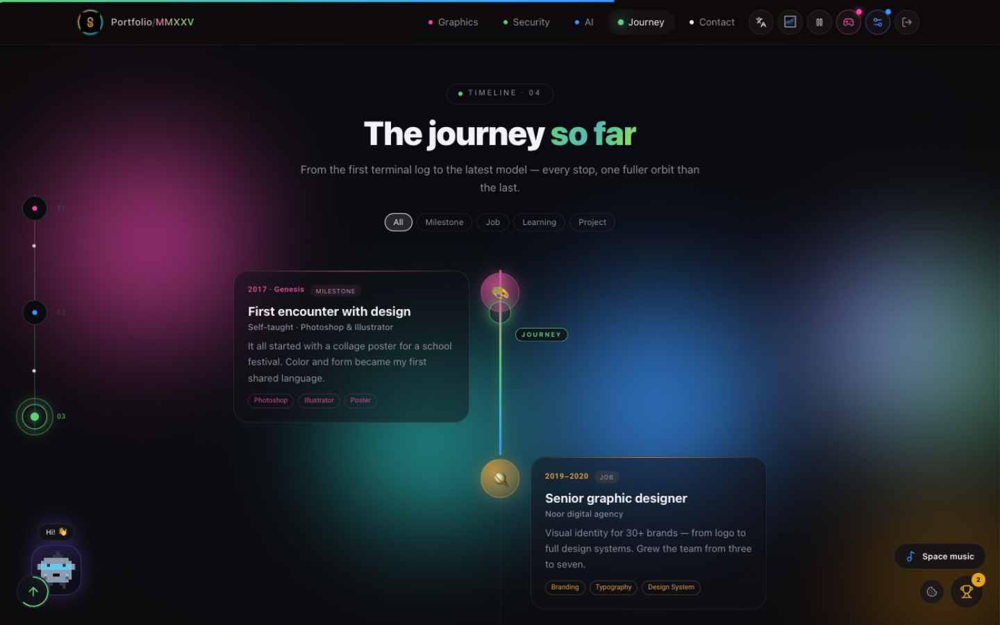
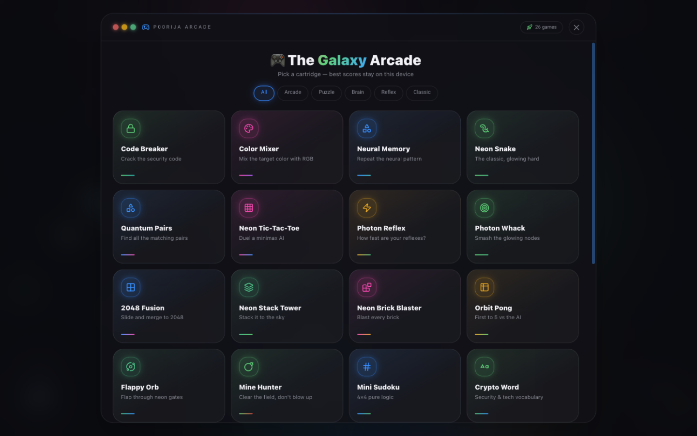
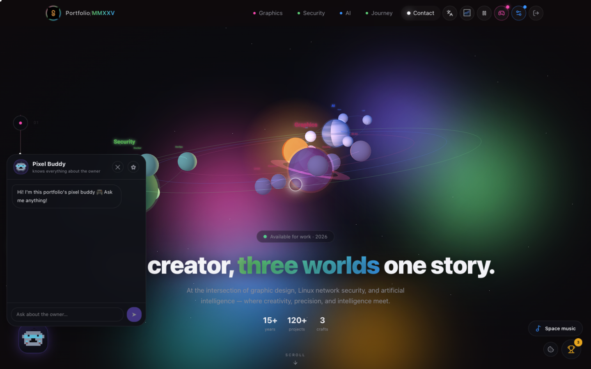

<div align="center">



# P00RIJA Portfolio

**Interactive bilingual 3D portfolio · CMS · Arcade · Access Guard**
**پورتفولیوی تعاملی دوزبانه‌ی سه‌بعدی · سیستم مدیریت محتوا · آرکید · قفل رمز**

[](https://nextjs.org)
[](https://react.dev)
[](https://nodejs.org)
[](LICENSE-COMMERCIAL.md)

`v4.6.0` · Next.js 16 (App Router · Turbopack · standalone) · React 19 · Tailwind 4 · Prisma 6/SQLite · Three.js · Lenis — **tested with 1 CPU / 512 MB RAM (about 101 MB idle runtime)** · Developer: [`p00rija@tutamail.com`](mailto:p00rija@tutamail.com)

</div>

---

## 🇬🇧 English

A single-page, space-themed portfolio with a full built-in CMS. Three orbiting worlds — **Graphics · Security · AI** — plus a timeline, a synthesis finale and a contact deck. Everything (content, theme, forms, galleries, SEO, PWA) is editable live from the CMS; nothing is tracked before visitor consent; commercial builds are license-gated.

> The public distribution starts in **Null mode** (`docker-compose.null.yml` / `P00RIJA_DISTRIBUTION_MODE=null`): no portfolio identity or sample content is shown until the owner signs in; only the immutable Developer card remains.

### ✨ Highlights

- 🪐 **3D planetary navigation** — click a planet, dive into its world
- 🧊 **21 procedural 3D objects** — bilingual Object Factory library with one live preview, graphics-specific sculptures, space models, robots, atoms, DNA, Möbius geometry, a gamepad, and more; all geometry is created in the visitor's browser with no external model downloads
- 🛰 **Walkable spaceship gallery** — dynamic CMS corridors, glass ceilings, space traffic, holographic About Me, and large physical project books with smooth drag/RTL page turns, keyboard movement, jumping, and mobile joystick controls
- 🔄 **Animated orbital loading** — lightweight Web Animations API orbits with slower reduced-motion behavior; shared across initial loading, galleries, books, and 3D previews
- 🖼 **Cinematic virtual galleries** — per-project media, specs and multi-links; a gallery can be added to **any** section
- 🔐 **Access Guard** — password-protect the **whole site**, any **section**, or **each gallery independently**: 4/6-digit PIN or text password, **temporary passwords with auto-expiry**, attempt-limited locks (bank-card style disable), server-side content withholding, `/gate` site-wide screen
- 🎮 **Galaxy Arcade** — 26 built-in games in a console-style overlay (header button or `G`), per-game high scores, RTL-safe controls
- 💻 **Interactive security terminal** — ~80 commands, TAB completion, local-only ASCII image/video rendering with 10 density levels, MATRIX/RGB/MONO output and PNG export, plus permission-based live webcam ASCII with full track cleanup and the `chose` Matrix pill scene
- 🧪 **Creative Lab** — ten browser-local interactive experiments: warp Starfield, procedural Plasma, zoomable Mandelbrot, Conway Life, gravity Particles, Harmonograph, ASCII Fire, generated Maze, Web Audio Synth, and Typing Test; open with `lab` or each experiment's own terminal command
- 📊 **First-party visitor analytics** — sessions, duration, IP & Geo-IP, browser/device, referrers, 30-day charts, live world map; cookie-free, Do-Not-Track aware, **nothing tracked before consent**
- 🛡 **Defense Center** — bot/scanner filtering, rate limiting, auto-bans, allow/block lists, live threat feed (Next 16 `proxy.ts`)
- 🧩 **Full CMS** — every section, theme, gallery layouts, drag-drop forms (Telegram/WhatsApp/SMTP delivery), music player, 3D object factory, per-device content snapshots, SEO fields, media library with ffmpeg-backed editing
- 🔒 Hardened auth — PBKDF2 password hash, optional TOTP 2FA, login lockout, HMAC sessions · 🍪 GDPR/CCPA consent gate
- 📦 One-file installer + clean zero-config Docker image

### 📸 Screenshots

| Hero — planetary system | Graphics world | Security world | AI world |
|:---:|:---:|:---:|:---:|
|  |  |  |  |

| Timeline | Synthesis finale | Galaxy Arcade | Pixel Buddy assistant |
|:---:|:---:|:---:|:---:|
|  |  |  |  |

### 🚀 Quick start

```bash
cp .env.example .env          # set AUTH_SECRET + ADMIN_PASSWORD
docker compose -f docker-compose.hub.yml up -d     # or docker-compose.null.yml (blank mode)
# http://localhost:7890 → gear icon in the header → log in → build your site
```

Local dev: `docker compose -f docker-compose.dev.yml up -d` → http://127.0.0.1:7890

<details>
<summary>Production deploy (build locally, ship an image — the server never builds)</summary>

```bash
bash scripts/make-clean-package.sh --image      # clean source + linux/amd64 image tar
bash scripts/deploy-image.sh user@your-server   # load + restart + health check
```
</details>

---

## 🇮🇷 فارسی

پورتفولیوی تک‌صفحه‌ای با حال‌وهوای فضایی و **CMS کامل داخلی**. سه سیاره‌ی مداری — **گرافیک · امنیت · هوش مصنوعی** — به‌همراه خط زمانی، بخش ترکیب و دک تماس. همه‌چیز (محتوا، تم، فرم‌ها، گالری‌ها، سئو، PWA) از داخل CMS و به‌صورت زنده قابل ویرایش است؛ هیچ داده‌ای قبل از رضایت بازدیدکننده ثبت نمی‌شود؛ نسخه‌ی تجاری فقط با لایسنس معتبر اجرا می‌شود.

> توزیع عمومی در **حالت خالی (Null)** شروع می‌شود: تا زمان ورود مالک، هیچ محتوا یا هویتی نمایش داده نمی‌شود؛ فقط کارت سازنده (غیرقابل تغییر) باقی می‌ماند.

### ✨ امکانات کلیدی

- 🪐 **ناوبری سیاره‌ای سه‌بعدی** — روی سیاره کلیک کنید و به دنیای آن شیرجه بزنید
- 🧊 **۲۱ آبجکت سه‌بعدی procedural** — کتابخانه دوزبانه Object Factory با یک پیش‌نمایش زنده، مجسمه‌های مخصوص گرافیک، مدل‌های فضایی، ربات، اتم، DNA، هندسه موبیوس، گیم‌پد و موارد دیگر؛ همه در مرورگر بازدیدکننده ساخته می‌شوند و فایل مدل خارجی نمی‌خواهند
- 🛰 **گالری قدم‌زدنی در فضاپیما** — راهروهای داینامیک CMS، سقف شیشه‌ای، ترافیک فضایی، About Me هولوگرافیک و کتاب‌های بزرگ پروژه با ورق نرم، drag و RTL، حرکت با کیبورد، پرش و joystick موبایل
- 🔄 **لودینگ مداری متحرک** — چرخش سبک با Web Animations API و حرکت آهسته‌تر در reduced-motion؛ مشترک در ورود، گالری، کتاب و پیش‌نمایش سه‌بعدی
- 🖼 **گالری‌های مجازی سینمایی** — رسانه، مشخصات و چند لینک برای هر پروژه؛ افزودن گالری به **هر بخش دلخواه**
- 🔐 **قفل رمز (Access Guard)** — پسورد روی **کل سایت**، هر **بخش** یا **هر گالری به‌صورت مستقل**: رمز ۴/۶ رقمی یا متنی، **رمز موقت با انقضای خودکار**، حالت سقف تلاش (غیرفعال‌شدن مثل کارت بانکی)، حذف محتوای واقعی از سمت سرور تا وارد کردن رمز، صفحه‌ی `/gate` برای قفل کل سایت
- 🎮 **مرکز بازی (Galaxy Arcade)** — ۲۶ بازی داخلی در اورلی کنسولی (دکمه‌ی هدر یا کلید `G`)، رکورد شخصی برای هر بازی، سازگار با راست‌به‌چپ
- 💻 **ترمینال امنیت تعاملی** — حدود ۸۰ دستور با تکمیل TAB، رندر محلی ASCII از تصویر/ویدیو با ۱۰ سطح Density، حالت‌های MATRIX/RGB/MONO و خروجی PNG؛ وب‌کم زنده با اجازه کاربر و توقف کامل trackها، به‌همراه صحنه `chose`
- 🧪 **آزمایشگاه خلاقیت** — ده تجربه تعاملی و کاملاً محلی: Starfield، Plasma، Mandelbrot با zoom، Conway Life، Particles، Harmonograph، ASCII Fire، Maze تصادفی، Synth با Web Audio و Typing Test؛ اجرا با `lab` یا نام هر تجربه در ترمینال
- 📊 **آمار بازدیدکننده‌ی اختصاصی** — نشست‌ها، مدت حضور، موقعیت جغرافیایی، مرورگر/دستگاه، نمودار ۳۰ روزه، نقشه‌ی زنده؛ بدون کوکی، با احترام به Do-Not-Track و **بدون ثبت هیچ داده‌ای قبل از رضایت**
- 🛡 **مرکز سد دفاعی** — بلاک ربات/اسکنر، محدودیت نرخ، بن خودکار، فهرست‌های بلاک/مجاز، فید زنده تهدیدها
- 🧩 **CMS کامل** — سکشن‌ها، تم، چیدمان گالری، فرم‌ساز کشیدنی (تحویل تلگرام/واتساپ/SMTP)، پخش‌کننده موسیقی، کارخانه شیء سه‌بعدی، محتوای تفکیک‌شده برای هر دستگاه، سئو، کتابخانه رسانه با ویرایش ffmpeg
- 🔒 احراز هویت سخت‌شده — هش PBKDF2، کد دوعاملی اختیاری، قفل لاگین، نشست‌های HMAC · 🍪 دروازه رضایت GDPR/CCPA
- 📦 نصب‌کننده‌ی تک‌فایلی + ایمیج داکر تمیز و بدون نیاز به تنظیم

### 📸 اسکرین‌شات‌ها

| صفحه اصلی | دنیای گرافیک | دنیای امنیت | دنیای هوش مصنوعی |
|:---:|:---:|:---:|:---:|
|  |  |  |  |

| خط زمانی | ترکیب | آرکید | همدم پیکسلی |
|:---:|:---:|:---:|:---:|
|  |  |  |  |

### 🚀 شروع سریع

```bash
cp .env.example .env          # مقادیر AUTH_SECRET و ADMIN_PASSWORD را تنظیم کنید
docker compose -f docker-compose.hub.yml up -d     # یا docker-compose.null.yml (حالت خالی)
# http://localhost:7890 → آیکون چرخ‌دنده در هدر → ورود → ساخت سایت
```

توسعه‌ی محلی: `docker compose -f docker-compose.dev.yml up -d` → http://127.0.0.1:7890

<details>
<summary>دیپلوی پروداکشن (بیلد محلی، ارسال ایمیج — سرور هرگز بیلد نمی‌کند)</summary>

```bash
bash scripts/make-clean-package.sh --image      # پکیج تمیز + ایمیج linux/amd64
bash scripts/deploy-image.sh user@your-server   # بارگذاری + ری‌استارت + بررسی سلامت
```
</details>

---

## 🔐 Licensing · لایسنس

The commercial build **runs only with a valid signed license** (`.lic` file or `P00LIC1.` activation code — AES-256-GCM + Ed25519), verified on activation, on every request, and through a periodic heartbeat to the vendor's licensing endpoint; revocation, expiry or a burned-out grace window switches the site to a maintenance screen and it recovers automatically. Licenses are purchased from the vendor — see [`LICENSE-COMMERCIAL.md`](LICENSE-COMMERCIAL.md).

نسخه‌ی تجاری **فقط با فایل لایسنس امضاشده‌ی معتبر** اجرا می‌شود؛ لغو لایسنس، انقضا یا قطعی طولانی سرور، سایت را به حالت نگهداری می‌برد و با معتبر شدن دوباره به‌صورت خودکار بازیابی می‌شود.

**© P00RIJA** · [`p00rija@tutamail.com`](mailto:p00rija@tutamail.com) · Proprietary Commercial — see [LICENSE-COMMERCIAL.md](LICENSE-COMMERCIAL.md)
